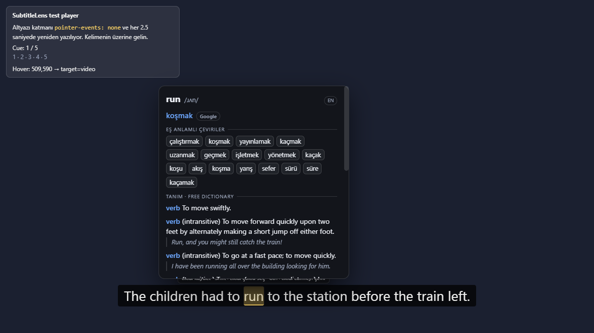
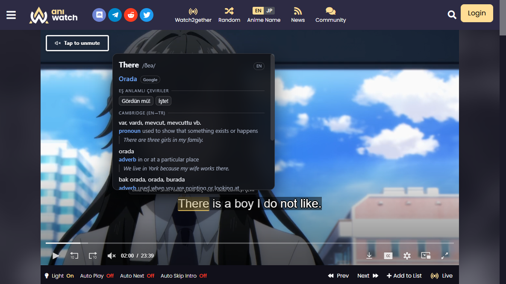
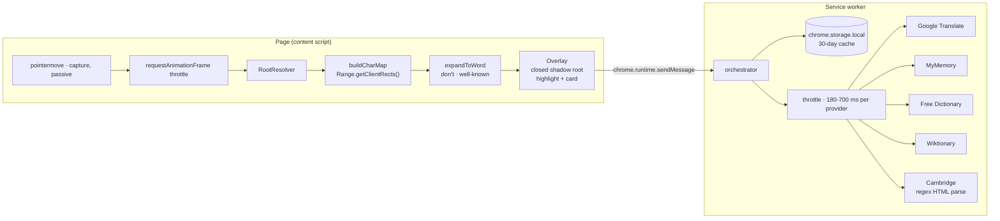

# SubtitleLens

Hover any word in a video subtitle and get an instant translation, IPA
pronunciation and Cambridge dictionary entries — on Netflix, YouTube, Prime
Video, Disney+ or any site with a caption container.

A Chrome extension (Manifest V3). No account, no API key, no backend, and every
data source is free.



## Why it is built this way

Streaming players make word-level interaction hostile, so the design follows
from the constraints rather than from convenience:

| Constraint | What players do | How SubtitleLens answers it |
| --- | --- | --- |
| The caption layer ignores the mouse | Netflix sets `pointer-events: none` on `.player-timedtext` | Hit testing is bypassed entirely. The character map is built from `Range.getClientRects()`, which does not depend on pointer events |
| The cue DOM is replaced constantly | Netflix and Prime Video rebuild cue nodes on **every** cue change | The page DOM is never mutated. The overlay lives in a `position: fixed` host outside the player subtree, so a rewrite cannot destroy it |
| Subtitle text is split per word | `.player-timedtext-text-container` holds one `<span>` per word | A virtual space is inserted between text runs, so `don't` and `well-known` stay single tokens |
| The player owns the whole screen | In fullscreen only the fullscreen element is rendered | The overlay host is re-parented into `document.fullscreenElement` on `fullscreenchange` |
| Player CSS fights injected UI | Global selectors, `!important` resets | The card and highlight render inside a **closed** shadow root |

## Install

```bash
git clone https://github.com/raksix/subtitle-lens.git
cd subtitle-lens
bun build.mjs   # produces dist/
```

Then in Chrome:

1. `chrome://extensions`
2. Enable **Developer mode**
3. **Load unpacked** → select the `dist/` directory

Requires Chrome 116+. The runtime has no dependencies; `bun install` is only
needed for editor types.

## Usage

Open a video with subtitles, hover a word, wait ~120 ms.

| Control | Behaviour |
| --- | --- |
| Hover a word | Highlight plus a card with translation, IPA and definitions |
| Move onto the card | The card stays open. Words between the caption and the card are crossable, and scrolling inside the card never closes it |
| **Click a word** | Adds it to your dictionary |
| **Shift + click** | Collects words without saving; **S** saves them all |
| **Ctrl + click** | Translates the whole caption line |
| `Esc` | Closes everything, or clears an active selection |
| 🔊 Dinle | Speaks the source word via `speechSynthesis` |
| Geçmiş | Shows past encounters of that word, inside the card |

The toolbar popup holds the language switch, the timing controls and a per-site
CSS selector for players the built-in adapters do not cover.

## Supported sites

Two layers, because streaming sites differ in kind:

**Hostname adapters** for players that live on a known domain: Netflix
(`.player-timedtext`), YouTube (`.ytp-caption-segment`), Prime Video
(`.atvwebplayersdk-captions-overlay`), Disney+, HBO Max and MUBI.

**Embedded-player adapters** for anime and other streaming sites that put a
third-party player inside an `<iframe>` on a domain of its own. The hostname says
nothing there, so the player is recognised by its caption markup — and the
content script reaches inside the frame because it declares `all_frames: true`.
Aniwatch, HiAnime and most of that family serve **JW Player**, whose captions are
`.jw-text-track-cue`. Also covered: video.js (`.vjs-text-track-cue`), Shaka
Player, hls.js, Fluid Player, ArtPlayer and Plyr.



That is a real hover on a live Aniwatch stream: the frame recognises the player
as `jwplayer`, the hover resolves `There` inside the running cue, and the card
renders the translation, the phonetic and the Cambridge entry.

On unknown sites a heuristic looks for `[class*="caption"]`,
`[class*="subtitle"]`, `[role="caption"]` and similar containers in the lower
part of the viewport, where subtitles actually are.

For anything else, open the popup → **Bu site için gelişmiş** and paste a
selector, or set one globally in Options.

## Sözlüğüm (the library)

Open it from the popup or Options. Three tabs:

- **Kelimeler** — every saved word with its translation, the site it came from,
  how many times you met it, and whether its review is due. Search, sort by
  recency / frequency / due date, and export as JSON or CSV (UTF-8 with a BOM, so
  Excel keeps the Turkish characters).
- **Tekrar** — a review session. The card shows the word first; reveal the
  answer, then grade yourself. A word you knew comes back later, a word you
  missed comes back within the same session. `Space` reveals, `1`/`2` grade.
  Scheduling is Leitner-style: 1, 3, 7, 16, 35 and 75 days.
- **Geçmiş** — every word you hovered, newest first, with the option to save one
  to the dictionary or clear the list.

Lookups are recorded automatically but common words are skipped by default, so a
film does not fill the list with "the" and "of".

## Keeping it up to date

An extension installed from a store updates itself through the `update_url`
declared in its manifest. The check built here serves the other case — a manual
(unpacked) install, where Chrome cannot update anything on its own:

- On install and twice a day, the service worker asks the GitHub Releases API for
  the newest tag and compares it against `chrome.runtime.getManifest().version`.
- When it is newer, the toolbar icon gets a **NEW** badge, the popup and the
  library show a button to the release, and Options shows the date of the last
  check.
- A failed check never overwrites the last known release; the previous answer is
  kept and the error is shown alongside it.

`tools/make-update.mjs` packs the extension, signs it with a persistent key and
writes the `update.xml` a self-hosted `update_url` needs:

```bash
bun tools/make-update.mjs --url https://example.com/subtitle-lens/
# → dist-crx/subtitle-lens.crx
# → dist-crx/subtitle-lens.pem   (SIGNING KEY — keep it out of the repository)
# → dist-crx/update.xml
```

The private key is the identity of the extension: replacing it makes every
installed copy a different extension. It is written to `dist-crx/`, which is
gitignored.

## When a lookup fails

| Purpose | Source | Notes |
| --- | --- | --- |
| Translation | `translate.googleapis.com/translate_a/single` | Primary. Returns the main gloss, part-of-speech alternatives and a romanisation |
| Translation (fallback) | `api.mymemory.translated.net` | Used automatically when Google fails or is rate-limited |
| Definitions | `freedictionaryapi.com` | Structured senses and IPA pronunciations |
| Definitions (fallback) | `en.wiktionary.org` REST | Used when the free dictionary has no entry |
| Cambridge | `dictionary.cambridge.org` | Scraped HTML; `english-turkish` when the target language is Turkish |

`api.dictionaryapi.dev` is deliberately **not** used: it answered HTTP 522
throughout development.

**On the Cambridge source.** Cambridge sends no `Access-Control-Allow-Origin`
header, so a page cannot read its responses. The request is made from the
extension's service worker instead, under the host permission declared in
`manifest.json`. This is HTML scraping of a third-party site: it can break when
Cambridge changes markup, and it is intended for personal use.

## Architecture



Requests are coalesced per word across tabs, cached for 30 days, and throttled
per provider. `DOMParser` does not exist in a service worker, so Cambridge HTML
is parsed with anchored regexes over the raw response string.

### Layout

```
src/
  common/
    settings.js               defaults, language list, common-word list
    words.js                  word identity, merge rules, review scheduling
    version.js                version comparison for the update check
  background/service-worker.js
                              fetch proxy, cache, throttle, providers, Cambridge
                              parser, word list, history, update check
  content/
    dom-utils.js              character map, token expansion, rect merging
    adapters.js               hostname + embedded-player selectors, root resolution
    overlay.js                shadow-root markup, highlight, card, line panel
    hover.js                  pointer → word → lookup / select / translate
    index.js                  entry point
  library/                    Sözlüğüm: words, review session, history
  popup/  options/            settings surfaces
tools/make-update.mjs         pack + sign the crx and write update.xml
build.mjs                     bundles the content script to an IIFE, copies the rest
```

A content script cannot be an ES module, so `src/content/*` is flattened by
`bun build.mjs` into `dist/src/content.js`. Everything else is loaded by Chrome
as a real ES module and copied unchanged.

## When a lookup fails

The providers are free public endpoints, so failures are a normal condition
rather than an edge case. Three rules keep them from turning into a broken word:

- **Rate limits fall through instead of giving up.** Google's endpoint starts
  answering `429` after a burst of lookups, which is exactly what a subtitle
  session is. A second Google host is tried before MyMemory, and only a total
  failure is reported.
- **A refusal is not a translation.** MyMemory answers `200 OK` with the error
  text inside `responseData.translatedText` (`'XX' IS AN INVALID TARGET
  LANGUAGE`). That string is detected and rejected instead of being rendered as
  if it were the answer.
- **A partial answer is never cached as a whole one.** A result without a
  translation is either rate limited or transient, so it is kept for one minute
  and retried, not for the full 30 days. Otherwise a single `429` would pin the
  word for a month.

The card names what failed, in Turkish, without leaking a provider status code:

| Situation | What the card shows |
| --- | --- |
| Translation rate limited | `çeviri şu an sınırda (çok fazla istek). Birkaç saniye sonra tekrar deneyin.` |
| Translation fine, dictionary rate limited | the translation, then `sözlük sonucu alınamadı.` |
| Nothing found at all | `Bu kelime için sonuç bulunamadı.` |
| Extension reloaded under a live page | `Eklenti güncellendi. Sayfayı yenileyin (F5) ve tekrar deneyin.` |

## Development

```bash
bun build.mjs                             # bundle dist/
bun run check                             # parse every source file
bun run test                              # provider + word-list tests, no browser
bun test/serve.mjs 8123                   # serve the repo (demo player at /test/demo.html)
```

End-to-end, with a browser:

```bash
bun run e2e                               # build, restart Chrome, run every browser suite
bun run e2e -- -Suite interactions        # or just one
```

`test/run-e2e.ps1` does the whole chain: build, stop the *test* browser on a fresh
profile, install the extension over CDP, verify.

### Things that will bite you

- **`--load-extension` is dead.** Branded Chrome builds ignore it since Chrome
  137. The harness installs `dist/` with the CDP `Extensions.loadUnpacked`
  command, which requires `--enable-unsafe-extension-debugging`.
- **A rebuild needs a fresh profile.** Chrome registers an unpacked extension and
  keeps serving its scripts from that registration, so a stale profile runs stale
  code even after a successful build. Wiping is not enough on Windows — a profile
  that was just closed still has locked files — so `launch-chrome.ps1` allocates a
  new directory (`lens-chrome-<timestamp>`) on every run.
- **Never `taskkill /IM chrome.exe`.** The user's own browser is almost always
  running; only processes whose command line contains `lens-chrome-` belong to
  this harness. Matching on the image name has killed a live user session.
- **A hidden page stops `requestAnimationFrame`,** and the hover pipeline is
  frame-driven, so the harness calls `Emulation.setFocusEmulationEnabled`.
- **The service worker needs `Target.attachToTarget` with `flatten: true`.** Its
  `/json/list` entry has no websocket URL and ids there go stale when it suspends.
  Timers and storage are easier to observe from an extension page instead — that
  is what `verify-interactions.mjs` does.

`test/demo.html` reproduces the hostile behaviours that matter: the caption layer
is `pointer-events: none`, **and** the cue DOM is rebuilt every 2.5 s. It exposes
`window.__lensTest` (`pause`, `seek`, `next`, `wordPoint`) so a check can aim at a
known word and swap the cue mid-hover on purpose.

The assertions read the card through `DOM.getDocument { pierce: true }` because
the overlay lives in a **closed** shadow root: invisible to page scripts, visible
to CDP.

`test/providers.test.mjs` and `test/words.test.mjs` need none of that. They run
the service worker as a plain module with a stubbed `chrome` and a scripted
`fetch`, which keeps every failure path deterministic: no rate limits, no network,
no browser.

## Verified behaviour

| Suite | Scope | Result |
| --- | --- | --- |
| `providers.test.mjs` | fallback chains, provider refusals, cache rules, Cambridge parsing, whole-line translation | **25/25** |
| `words.test.mjs` | word list merge rules, review scheduling, history, update check | **42/42** |
| `verify.mjs` | hover on a `pointer-events: none` layer in a real Chrome 155 | **19/19** |
| `check-pages.mjs` | popup, options, service worker | **8/8** |
| `verify-ui-errors.mjs` | what the card says when providers fail | **8/8** |
| `verify-interactions.mjs` | reach corridor, transparency, click-to-save, Shift multi-select, Ctrl line translation, library, popup | **43/43** |

What the browser runs actually assert:

| Check | Observed |
| --- | --- |
| Caption layer is `pointer-events: none` | confirmed before hovering |
| Cue DOM is rebuilt per word | 12 spans per cue; cue swapped mid-test |
| Highlight alignment | highlight `485.8,572.3` vs word `486,572` |
| Translation | `run /rʌn/ EN koşmak Google` |
| Cambridge EN→TR | `koşmak, seğirtmek` · `verb` |
| Pointer crosses the gap to the card | card open through 8 intermediate steps and while resting on it |
| Click to save | `0 → 1: station`, with translation `istasyon` and the cue as context |
| Shift + click | `["children"]` → `["children","station"]` → save writes both |
| Ctrl + click | `Çocuklar tren kalkmadan önce istasyona koşmak zorunda kaldılar.` |
| Aniwatch / JW Player | player recognised as `jwplayer` inside the frame; hover on the live stream returned `There /ðeə/ EN Orada Google` with the Cambridge EN→TR entry |
| Card survives a cue rewrite | word replaced under the card, card intact |
| Second lookup | served with the `cached` badge |

Not verified end to end: real Netflix or Prime Video accounts (both need a
subscription and DRM playback) and fullscreen inside a DRM session. The
fullscreen re-parenting path is exercised only by the demo page.

## Limitations

- Cambridge results depend on their markup staying as observed. The parser
  tolerates attribute order but not class renames.
- Google's `translate_a/single` is undocumented. It is used with a fallback, but
  it is not a contract.
- The generic heuristic only inspects the lower 65 % of the viewport. Captions
  rendered elsewhere need a manual selector.
- `speechSynthesis` voice quality and availability depend on the OS.
- Firefox and Safari are not supported (Manifest V3 service-worker model).

## License

MIT
