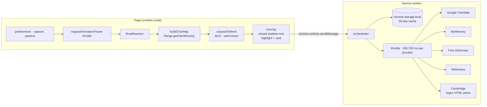

# SubtitleLens

Hover any word in a video subtitle and get an instant translation, IPA
pronunciation and Cambridge dictionary entries — on Netflix, YouTube, Prime
Video, Disney+ or any site with a caption container.

A Chrome extension (Manifest V3). No account, no API key, no backend, and every
data source is free.


## Why it is built this way

Streaming players make word-level interaction hostile, so the design follows
from the constraints rather than from convenience:

| Constraint | What players do | How SubtitleLens answers it |
| --- | --- | --- |
| The caption layer ignores the mouse | Netflix sets `pointer-events: none` on `.player-timedtext` | Hit testing is bypassed entirely. The character map is built from `Range.getClientRects()`, which does not depend on pointer events |
| The cue DOM is replaced constantly | Netflix and Prime Video rebuild cue nodes on **every** cue change | The page DOM is never mutated. The overlay lives in a `position: fixed` host outside the player subtree, so a rewrite cannot destroy it |
| Subtitle text is split per word | `.player-timedtext-text-container` holds one `<span>` per word | A virtual space is inserted between text runs, so `don't` and `well-known` stay single tokens |
| The player owns the whole screen | In fullscreen only the fullscreen element is rendered | The overlay host is re-parented into `document.fullscreenElement` on `fullscreenchange` |
| Player CSS fights injected UI | Global selectors, `!important` resets | The card and highlight render inside a **closed** shadow root |

## Install

```bash
git clone https://github.com/raksix/subtitle-lens.git
cd subtitle-lens
bun build.mjs   # produces dist/
```

Then in Chrome:

1. `chrome://extensions`
2. Enable **Developer mode**
3. **Load unpacked** → select the `dist/` directory

Requires Chrome 116+. The runtime has no dependencies; `bun install` is only
needed for editor types.

## Usage

Open a video with subtitles, hover a word, wait ~120 ms.

| Control | Behaviour |
| --- | --- |
| Hover a word | Highlight plus a card with translation, IPA and definitions |
| Move onto the card | The card stays open so you can read and copy from it |
| `Esc`, click elsewhere, or scroll | Close |
| 🔊 Dinle | Speaks the source word via `speechSynthesis` |
| Kopyala | Copies the translation |

The toolbar popup holds the language switch and a per-site CSS selector for
players that the built-in adapters do not cover.

## Supported sites

Built-in adapters for Netflix (`.player-timedtext`), YouTube
(`.ytp-caption-segment`), Prime Video
(`.atvwebplayersdk-captions-overlay`), Disney+, HBO Max and MUBI. On unknown
sites a generic heuristic looks for `[class*="caption"]`, `[class*="subtitle"]`,
`[role="caption"]` and similar containers in the lower part of the viewport,
where subtitles actually are.

For anything else, open the popup → **Bu site için gelişmiş** and paste a
selector, or set one globally in Options.

## Data sources

| Purpose | Source | Notes |
| --- | --- | --- |
| Translation | `translate.googleapis.com/translate_a/single` | Primary. Returns the main gloss, part-of-speech alternatives and a romanisation |
| Translation (fallback) | `api.mymemory.translated.net` | Used automatically when Google fails or is rate-limited |
| Definitions | `freedictionaryapi.com` | Structured senses and IPA pronunciations |
| Definitions (fallback) | `en.wiktionary.org` REST | Used when the free dictionary has no entry |
| Cambridge | `dictionary.cambridge.org` | Scraped HTML; `english-turkish` when the target language is Turkish |

`api.dictionaryapi.dev` is deliberately **not** used: it answered HTTP 522
throughout development.

**On the Cambridge source.** Cambridge sends no `Access-Control-Allow-Origin`
header, so a page cannot read its responses. The request is made from the
extension's service worker instead, under the host permission declared in
`manifest.json`. This is HTML scraping of a third-party site: it can break when
Cambridge changes markup, and it is intended for personal use.

## Architecture



Requests are coalesced per word across tabs, cached for 30 days, and throttled
per provider. `DOMParser` does not exist in a service worker, so Cambridge HTML
is parsed with anchored regexes over the raw response string.

### Layout

```
src/
  common/settings.js          defaults and the language list, shared by every surface
  background/service-worker.js
                              fetch proxy, cache, throttle, providers, Cambridge parser
  content/
    dom-utils.js              character map, token expansion, rect merging
    adapters.js               per-site selectors, root resolution, deep shadow query
    overlay.js                shadow-root markup, highlight boxes, card rendering
    hover.js                  pointer → word → lookup state machine
    index.js                  entry point
  popup/  options/            settings surfaces
build.mjs                     bundles the content script to an IIFE, copies the rest
```

A content script cannot be an ES module, so `src/content/*` is flattened by
`bun build.mjs` into `dist/src/content.js`. Everything else is loaded by Chrome
as a real ES module and copied unchanged.

## Development

```bash
bun build.mjs                             # bundle dist/
bun run check                             # parse every source file
bun test/serve.mjs 8123                   # serve the repo (demo player at /test/demo.html)
```

End-to-end, in two more terminals:

```bash
powershell -File test/launch-chrome.ps1   # Chrome with CDP on :9222
bun test/verify.mjs                       # hover, translate, dismiss — 19 checks
bun test/check-pages.mjs                  # popup, options, service worker — 8 checks
```

`test/run-e2e.ps1` does the whole chain: build, restart Chrome on a clean
profile, install the extension over CDP, verify.

Two things make the harness work, and both matter if you touch it:

- **`--load-extension` is dead.** Branded Chrome builds ignore it since Chrome
  137. `test/verify.mjs` installs `dist/` with the CDP `Extensions.loadUnpacked`
  command instead, which requires `--enable-unsafe-extension-debugging`. The
  consequence: an unpacked extension is never reloaded from disk, so **every
  rebuild needs a fresh browser** — which is why `run-e2e.ps1` wipes the profile.
- **A hidden page stops `requestAnimationFrame`.** The hover pipeline is
  frame-driven, so a background tab would never process a pointer move. The
  harness calls `Emulation.setFocusEmulationEnabled`, matching the state a real
  visible tab is in.

`test/demo.html` reproduces the two hostile behaviours that matter: the caption
layer is `pointer-events: none` **and** the cue DOM is rebuilt every 2.5 s. It
exposes `window.__lensTest` (`pause`, `seek`, `next`, `wordPoint`) so the check
can aim at a known word and can swap the cue mid-hover on purpose.

The assertions read the card through `DOM.getDocument { pierce: true }` because
the overlay lives in a closed shadow root: invisible to page scripts, visible to
CDP.

## Verified behaviour

`test/verify.mjs` and `test/check-pages.mjs` run against a live Chrome 155 with
the extension installed from `dist/`. Latest run: **19/19** on the hover path,
**8/8** on the UI surfaces and service worker.

What the hover run asserts on `test/demo.html`:

| Check | Observed |
| --- | --- |
| Caption layer is `pointer-events: none` | confirmed before hovering |
| Cue DOM is rebuilt per word | 12 spans per cue; cue swapped mid-test |
| Pointer pipeline ran | `{"moves":4,"frames":4,"roots":4,"tokens":1}` |
| Highlight alignment | highlight `485.8,572.3` vs word `486,572` |
| Translation | `run /rʌn/ EN koşmak Google` |
| Cambridge EN→TR | `koşmak, seğirtmek` · `verb` |
| Card survives a cue rewrite | word replaced under the card, card intact |
| `Escape` dismisses | highlight removed |
| Second lookup | served with the `cached` badge |

Not verified end to end: real Netflix or Prime Video accounts (both need a
subscription and DRM playback) and fullscreen inside a DRM session. The
fullscreen re-parenting path is exercised only by the demo page.

## Limitations

- Cambridge results depend on their markup staying as observed. The parser
  tolerates attribute order but not class renames.
- Google's `translate_a/single` is undocumented. It is used with a fallback, but
  it is not a contract.
- The generic heuristic only inspects the lower 65 % of the viewport. Captions
  rendered elsewhere need a manual selector.
- `speechSynthesis` voice quality and availability depend on the OS.
- Firefox and Safari are not supported (Manifest V3 service-worker model).

## License

MIT
